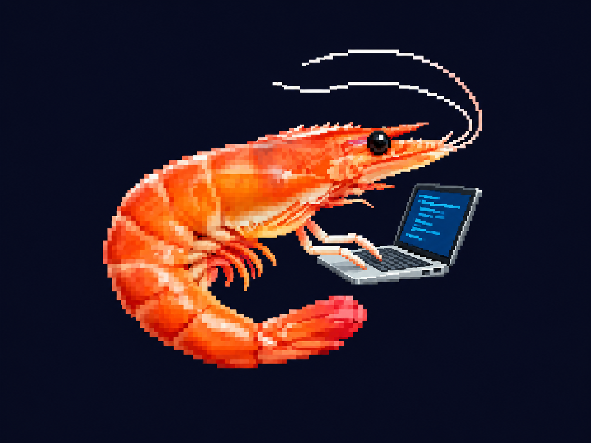

  

<h1 align="center">Hi 👋, I'm LowMath</h1>

  <strong>Software Engineering Student</strong> · Backend &amp; Mobile Enthusiast · 🇵🇪 Peru

  
  

 

<table>
  <tr>
    <td width="67%" valign="top">
      <h2>👨‍💻 About Me</h2>
      <ul>
        <li>🎓 Studying <strong>Software Engineering</strong> at <strong>UPC</strong>.</li>
        <li>🌱 Always learning more about <strong>backend, mobile development and cloud technologies</strong>.</li>
        <li>🧠 I enjoy understanding how things work, solving problems and learning something new.</li>
        <li>🦐 Big fan of <strong>Neocaridina shrimp</strong> — tiny aquatic creatures with a lot of personality.</li>
      </ul>
      
<em>Powered by curiosity, code and shrimp energy.</em>

    </td>
    <td width="33%" valign="middle" align="center">
      
       
      my little coding buddy 🦐
    </td>
  </tr>
</table>

 

### 🧑‍💻 Languages

  

### ⚙️ Frameworks &amp; Libraries

  

### 🛠️ Tools &amp; Technologies

  

### 🔭 Things I'm Interested In

- 🧩 Software architecture, APIs and clean code
- 📱 Cross-platform and native mobile development
- ☁️ Cloud infrastructure, automation and DevOps
- 🧪 Testing, performance and maintainable software
- 🌿 Aquariums and keeping Neocaridina shrimp

 

### 📊 GitHub Stats

  

### 📈 Contribution Activity

  

 

  <b>Let's connect!</b> 
  <a href="https://lowmath.dev/">Portfolio</a> ·
  <a href="mailto:mateoloechle@outlook.com">Email</a> ·
  <a href="https://github.com/LowMathzzz">GitHub</a>

  Built with curiosity, aurora light and a pixelated Neocaridina. 🦐

  Banner based on <a href="https://github.com/beydemirfurkan/awesome-github-profile/tree/main/templates/09-avant-garde/aurora-veil">Aurora Veil</a>.

